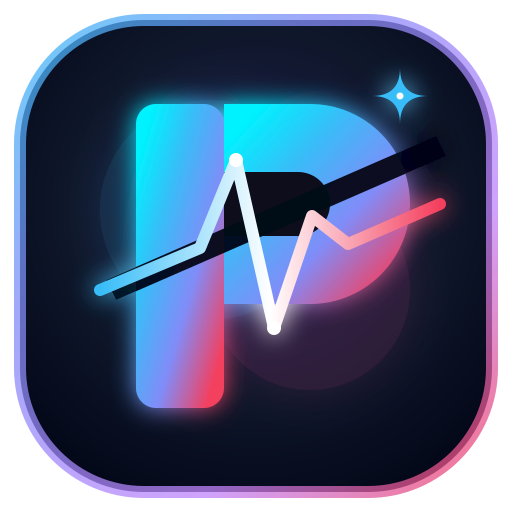

# PulseCut AI — Long Video to Shorts Studio

<div align="center">
  
  <h3>Turn Long Videos Into Scroll-Stopping Shorts — Powered by Cloud AI</h3>
  <p>
    <a href="https://pulsecut-ai.vercel.app" target="_blank"><strong>🌐 Live Demo</strong></a> •
    <a href="https://pulsecut-ai.vercel.app/studio" target="_blank"><strong>🎬 Open Studio</strong></a> •
    <a href="DEPLOYMENT.md"><strong>🚀 Deployment Guide</strong></a>
  </p>
  <p>
    
    
    
    
  </p>
</div>

---

## 🚀 What Is PulseCut AI?

**PulseCut AI** is a production-quality studio for converting long horizontal, vertical, or square videos into multiple professionally edited social-media Shorts. Video processing runs in a **cloud media worker** (Docker + FFmpeg), while the Next.js frontend is deployed serverlessly on Vercel — giving you professional codec quality without in-browser limitations.

> Upload your video → the frontend sends it to a dedicated media worker → FFmpeg encodes professional H.264 clips → you download the results.

---

## ✨ Key Features

| Feature | Description |
|---|---|
| 🎬 **Smart Clip Splitter** | Mathematically exact split into 9:16 Shorts (15s–180s per clip) |
| 🖼️ **AI Smart Reframe** | 8 strategies: Center, Face Focus, Fit+Blur, Speaker Focus, Gameplay, Manual |
| 📝 **Kinetic Subtitle Engine** | 12 animated subtitle themes (Karaoke, TikTok Bold, Neon, etc.) |
| 🔊 **Full Audio Export** | FFmpeg AAC pipeline — sound included in every MP4 |
| ✏️ **Custom Filenames** | Rename each Short before downloading |
| 📱 **Platform Presets** | YouTube Shorts, TikTok, Instagram Reels, X, Threads (safe zones included) |
| 🎯 **Hook Generator** | AI-generated viral opener text for each clip |
| ⚡ **Hardware Acceleration** | Auto-detects NVENC / QSV / AMF — falls back to libx264 on CPU |
| 🔄 **Real-Time Progress** | SSE stream pushes live FFmpeg progress to the browser |
| ☁️ **Cloud Storage** | Outputs stored on Cloudflare R2 (free egress) or any S3-compatible store |

---

## 🏗️ Architecture

```
Browser (Next.js on Vercel)
   │
   ├─ POST /api/upload  ──────────────────▶ Media Worker (Docker)
   │                                              │
   ├─ GET  /api/jobs/:id/events (SSE) ◀──────── FFmpeg processing
   │                                              │
   └─ GET  /api/downloads/:file ◀─────────────── Output clips
                                                  │
                                         PostgreSQL + Redis + R2
```

The **media worker** is a Node.js HTTP server that wraps FFmpeg. It auto-detects GPU encoders (NVENC, QSV, AMF) and falls back to `libx264` on CPU — which is reliable for all supported resolutions.

---

## 🛠️ Tech Stack

- **Framework**: Next.js 15 (App Router) + TypeScript
- **Styling**: Tailwind CSS v3 + custom design system
- **Video Processing**: FFmpeg (cloud worker, Docker) — full codec support incl. libass subtitles
- **Job Queue**: BullMQ + Redis (Upstash free tier supported)
- **Database**: PostgreSQL (Supabase free tier supported)
- **Storage**: Cloudflare R2 / AWS S3 / local disk
- **AI Hooks**: Gemini API (optional) + fallback NLP keyword extraction
- **Monorepo**: npm workspaces (`apps/web`, `packages/*`, `services/*`)

---

## 🗂️ Project Structure

```
pulsecut-ai/
├── apps/
│   └── web/                  # Next.js 15 frontend
│       ├── src/
│       │   ├── app/          # App Router pages + API routes
│       │   │   └── api/      # Proxy routes → media worker
│       │   ├── components/   # Navbar, Footer, ProcessingScreen
│       │   ├── lib/          # ssrfGuard, workerClient, subtitles
│       │   └── config/       # APP_CONFIG (brand, URLs, navigation)
│       └── public/           # Favicons, manifest.webmanifest
├── packages/
│   ├── shared/               # calculateClips, formatDuration utilities
│   ├── platform-presets/     # Platform safe zones + aspect ratios
│   └── video-config/         # Bitrate & codec configuration
├── services/
│   └── media-worker/         # Docker FFmpeg worker (Node.js HTTP)
│       ├── src/
│       │   ├── server.ts     # HTTP server entry point
│       │   ├── worker.ts     # Job state + HTTP handlers
│       │   ├── pipeline.ts   # FFmpeg encoding pipeline
│       │   ├── ffmpeg.ts     # Hardware detection
│       │   └── subtitles.ts  # ASS subtitle generation
│       └── Dockerfile.worker # Production Docker image
├── .env.example              # All environment variables documented
├── DEPLOYMENT.md             # Full cloud deployment guide
└── scripts/                  # generate_favicons.js
```

---

## ⚡ Local Development

```bash
# 1. Clone the repo
git clone https://github.com/Code-With-Bitwizards-20/pulsecut-local-ai.git
cd pulsecut-local-ai

# 2. Install dependencies
npm install

# 3. Copy and configure environment
cp .env.example .env
# Edit .env — at minimum set MEDIA_WORKER_URL=http://localhost:8080

# 4. Start the media worker (requires Docker and FFmpeg installed locally)
docker build -f services/media-worker/Dockerfile.worker -t pulsecut-worker .
docker run -p 8080:8080 --env-file .env pulsecut-worker

# 5. Start the Next.js dev server
npm run dev
# App is running at http://localhost:3000
```

> [!NOTE]
> For local development without Docker, install FFmpeg locally and run the worker directly:
> ```bash
> cd services/media-worker && npm run build && node dist/server.js
> ```

---

## 🌐 Deployment

PulseCut AI uses a two-service architecture. See **[DEPLOYMENT.md](DEPLOYMENT.md)** for the full step-by-step guide, including:

- Free-tier infrastructure recommendations (Vercel + Railway + Upstash + Supabase + Cloudflare R2)
- Docker deployment to Railway, Render, Fly.io, or self-hosted VPS
- Environment variable configuration
- Production readiness checklist
- Troubleshooting guide

**Quick deploy to Vercel (frontend only):**

[](https://vercel.com/new/clone?repository-url=https://github.com/Code-With-Bitwizards-20/pulsecut-local-ai)

> [!IMPORTANT]
> The Vercel deploy alone is not enough — you must also deploy the **media worker** Docker container. Without it, video processing will fail. See [DEPLOYMENT.md](DEPLOYMENT.md) → Step 7.

**Key environment variables for Vercel:**
```
MEDIA_WORKER_URL=https://your-worker.up.railway.app
WORKER_SECRET=your-32-char-random-secret
NEXT_PUBLIC_APP_URL=https://your-app.vercel.app
```

---

## 🤝 Built By

Designed & Developed with ❤️ by **[Code With Bitwizards](https://code-with-bitwizards.vercel.app/)**

[](https://code-with-bitwizards.vercel.app/)
[](https://github.com/Code-With-Bitwizards-20)
[](https://www.linkedin.com/in/codewithbitwizards1000)
[](https://www.fiverr.com/s/BRjgpyb)
[](https://www.upwork.com/freelancers/~01b261308dace9725e?mp_source=share)

---

## 📄 License

MIT License © 2026 Code With Bitwizards
